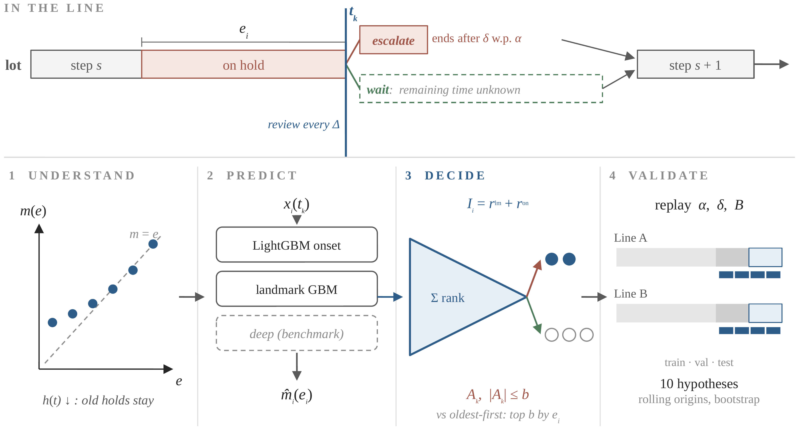

# lot-hold-escalation (v2.3.0)

Survival analysis of lot holds and a budgeted escalation index for semiconductor manufacturing lines.

Companion code for

> Surahman, D., and Y.-M. Hsieh. *Budgeted escalation of lot holds in semiconductor manufacturing: a remaining-time
> index evaluated on two production lines.* Submitted to the International Journal of Production Research.

Version 2.3.0 is the version cited in the manuscript. It contains all code and the aggregated results
behind every table and figure of the paper and of its Supplementary Material (see *Paper map* below).



## What the code does

| Step | Module | Output |
|---|---|---|
| Load MES hold events and map them to a neutral schema | `holdesc.io` | – |
| Anonymise codes, hash lot IDs, shift calendar time | `holdesc.anonymize` | – |
| Features at hold onset and at landmark times (no look-ahead) | `holdesc.features` | – |
| Hazard and mean residual life | `holdesc.survival` | Tables 2–3, Figure 2 |
| Onset models: Kaplan–Meier, Cox PH, log-normal AFT, XGBoost AFT, LightGBM | `holdesc.survival` | Table 4 |
| Landmark model of the remaining hold time | `holdesc.landmark` | Table 4, Figure 3 |
| Escalation index, due-date urgency, replay with a daily budget | `holdesc.policy` | Tables 5–6, Figure 4 |
| Bootstrap CIs (lots for discrimination, weeks for policies), Weibull shape | `holdesc.evaluate`, `holdesc.survival` | Tables 2, 4, 5 |

## Quick start (synthetic data)

```bash
pip install -r requirements.txt
python scripts/make_synthetic.py --out data/synthetic --holds 20000
python scripts/run_pipeline.py --config config/synthetic.yaml --out results_synthetic
```

The run takes a few minutes on a laptop. The synthetic data reproduce the structure of
the study data, not its values, so the synthetic results differ from the paper.

## Running on your own MES data

1. Export the hold transactions of the lots of the line you study (one row per hold,
   with start and release time) and, optionally, the completion time and customer due
   date of each lot.
2. Copy `config/schema.example.yaml` to `config/local.yaml` and map your column names.
   `config/local.yaml` and `data/` are git-ignored.
3. Set a private salt for the lot-ID hash: `export HOLDESC_SALT=<random string>`.
4. Run `python scripts/run_pipeline.py --config config/local.yaml --out results`.

## Confidentiality

The study data are confidential and are **not** part of this repository. The code is
written so that no company information can leave the machine where it runs:

* no plant-specific column name, code, path, or identifier appears in the code;
  all of them live in the git-ignored `config/local.yaml`;
* department, reason, step, product, and lot-type codes are replaced by rank-ordered
  labels (D1, R01, S001, ...) before any analysis; the code-to-label key stays in memory;
* lot IDs are replaced by salted hashes, and calendar time is shifted by whole weeks;
* `results*/` and `data/` are git-ignored;
* `tools/check_confidentiality.py` blocks a commit that contains data files, absolute
  paths, e-mail or IP addresses, compact timestamps, or any term listed in the
  git-ignored file `.confidential_terms` (company, customer, plant, tool, and internal
  code names; one per line).

Install the check as a pre-commit hook:

```bash
cp tools/pre-commit .git/hooks/pre-commit && chmod +x .git/hooks/pre-commit
```

## Target of the remaining-time models

The models estimate the remaining time truncated at tau, E[min(R, tau) | T > e], the same truncation as the credit
of the replay; holds older than tau therefore keep a positive index. Set `HOLDESC_TARGET=total` to use the
alternative target E[(min(T, tau) - e)^+ | T > e] instead.

## Additional analyses

`scripts/run_diagnostics.py` uses the same loading, split, models and replay as `run_hypotheses.py` and adds replay
diagnostics: censoring and truncation diagnostics, the replay with a credit truncated like
Equation (3), lateness of ensemble + urgency vs the plain ensemble, the refined age rule (oldest first among holds not
older than tau) and Kaplan-Meier on the test period and the rolling origins, escalation counts, and the weekly hold
volume (relative weeks, no dates).

```bash
export PYTHONPATH=src            # Windows PowerShell: $env:PYTHONPATH="src"
python scripts/run_diagnostics.py --line A=config/local_lineA.yaml --line B=config/local_lineB.yaml --out results_diagnostics
python scripts/run_diagnostics.py --line A=config/synthetic.yaml --line B=config/synthetic_B.yaml --out results_diagnostics_syn --quick
```

The archived output of this run on the two production lines is in `paper_results/diagnostics/` (Table 5 rows for
Kaplan-Meier and the refined age rule, Table 6 row H10 vs plain ensemble, Supplementary Tables S2 and S3).

`scripts/run_robustness.py` (same arguments) adds robustness checks: an escalation effect that worsens with hold
duration, the credit truncation tau, the percentile rule filled by oldest-first, overlap of holds of one lot, purged
labels, burn-in of the replay window, Weibull shapes within groups, and unseen categories in the test period.

`scripts/run_warmup.py` (same arguments) adds a warm-up replay in which every policy meets the backlog left by its own earlier decisions, the percentile rules on rolling origins, H6 with 200 draws, the hazard beyond τ, a sign-flip permutation test over weeks, the reasons the policies escalate, the footprint of past escalation rules, and the share of lateness that hold hours could explain. Its `local_only/` folder maps anonymised labels back to company codes and must never be shared.

`tools/check_references.py manuscript.docx` looks up every reference in Crossref (DOI, volume, issue, pages).

## Figures

* Figures 2–4 and all tables are rebuilt from the aggregated results by `scripts/make_paper.py`
  (see *Reproducing the paper*). If your own config uses other line names, set
  `HOLDESC_LINE_ALIAS="<name1>=A,<name2>=B"` before running it.
* `scripts/make_figures.py` is kept for the single-line pipeline (`run_pipeline.py`).

All figures are saved as 600-dpi PNG and as vector PDF.

## Outputs of `run_pipeline.py`

| File | Content |
|---|---|
| `table2_departments.csv` | durations by department, Weibull shape with 95% CI |
| `table3_residual_life.csv` | remaining hold time by elapsed time |
| `table4_landmark_metrics.csv` | C-index, AUC and top-10% capture at each landmark |
| `table4_pooled_ci.csv`, `table4_pooled_differences.csv` | pooled metrics with lot-bootstrap CIs and paired model differences |
| `table5_policies.csv` | recovered hold hours, lateness removed, block-bootstrap CIs vs age |
| `table6_sensitivity.csv` | sensitivity to the escalation effect (α, δ) |
| `summary.json` | data summary, onset C-indices, Weibull shape, feature importance |
| `figure2-4*.png/pdf` | result figures |

## Citation

See `CITATION.cff`. Please cite the paper and the archived software version (Zenodo DOI).

## Licence

MIT, see `LICENSE`.

## Paper map (v2.3.0)

Every number of the submitted manuscript comes from the files below. All are aggregated (no hold-level records,
anonymised labels, relative days only).

| Paper item | Script | Archived result in `paper_results/` |
|---|---|---|
| Table 1 (positioning), Table 3 (hypotheses) | text tables | `paper/table1_positioning.md`, `paper/table3_hypotheses.md` (repository root) |
| Table 2, Section 1 (hold share of cycle time), Section 3.1 (comment categories) | `run_hypotheses.py`, `run_match_txn.py`, `run_raw_extras.py` | `hypotheses/tables/*_line_summary.csv`, `match_txn/match_txn.md`, `warmup/raw_extras.md` |
| Section 5.1, Figure 2 (H1, H2) | `run_hypotheses.py`, `run_robustness.py` | `hypotheses/`, `robustness/`, `figures_data/fig2_*.csv` |
| Table 4, Supplementary Table S8 (H3, scores ranked within landmarks) | `run_rolling.py` | `rolling/pred_within_landmark*.csv`, `rolling/pred_by_landmark.csv` |
| Table 5, Figure 3 (H4, H5, H9; warm-up replay, rolling origins and test period) | `run_warmup.py` | `warmup/policies.csv`, `warmup/comparisons.csv`, `warmup/pooled.csv`, `figures_data/fig3_*.csv` |
| Table 6 (H6–H8 on rolling origins, α(e)), H10 | `run_rolling.py`, `run_warmup.py` | `rolling/ro_h6.csv`, `ro_h7.csv`, `ro_h8.csv`, `ro_policies.csv`, `warmup/delivery.csv` |
| Section 5.4, Figure 4, Supplementary S1 (benchmark) | `run_benchmark.py`, `run_bench_rolling.py` | `benchmark_A/`, `benchmark_B/` (tuning, test period), `bench_rolling/` (rolling origins, `windows/`, `non_overlapping/`), `figures_data/fig4_*.csv` |
| Supplementary S2 (censoring, escalation counts) | `run_diagnostics.py` | `diagnostics/diagnostics.csv` |
| Supplementary S3 (robustness, comments) | `run_robustness.py`, `run_warmup.py`, `run_rolling.py`, `run_match_txn.py` | `robustness/`, `warmup/`, `rolling/`, `match_txn/` |
| Supplementary S4 (windows), S5 (tail, footprint), S6 (pooled) | `run_diagnostics.py`, `run_warmup.py`, `run_rolling.py` | `diagnostics/rolling_windows.csv`, `warmup/tail.csv`, `warmup/footprint_*.csv`, `warmup/pooled.csv`, `rolling/ro_pooled.csv` |

Figures 2–4 of the submission are drawn from `paper_results/figures_data/` by

```bash
python scripts/make_submission_figures.py            # -> paper_output/figures/Figure2_*.{png,pdf,svg} ... Figure4_* (SVG text is editable)
```

### Order of the runs on the production data

All commands are run from the repository root with `PYTHONPATH=src` (PowerShell: `$env:PYTHONPATH="src"`);
`config/local_lineA.yaml` and `config/local_lineB.yaml` are the git-ignored configurations of the two lines.

1. `python scripts/run_hypotheses.py --line A=config/local_lineA.yaml --line B=config/local_lineB.yaml --out results_hyp`
2. `python scripts/run_benchmark.py --config config/local_lineA.yaml --out results_bench_A` (and Line B): tuning and test period
3. `python scripts/run_diagnostics.py ...` and `python scripts/run_robustness.py ...` (same `--line` arguments)
4. `python run_warmup_all.py --raw <raw folder> --lineA config/local_lineA.yaml --lineB config/local_lineB.yaml`
   (`run_warmup.py`: warm-up replay, Table 5, H5, H9, tail; `run_raw_extras.py`: comments)
5. `python scripts/run_match_txn.py --line A=... --line B=... --txn <transaction archive>` (hold share of cycle time)
6. `python run_rolling_all.py --lineA config/local_lineA.yaml --lineB config/local_lineB.yaml`
   (`run_rolling.py`: Table 4, H6–H8, α(e); `run_benchmark.py --origin 1..4 --fixed-hp`; `run_bench_rolling.py`)
7. `python scripts/make_submission_figures.py`

Steps 4–6 write a `local_only/` folder that maps anonymised labels back to company codes; it must never be shared.
Only the `EXPORT_*.zip` files (aggregated tables) may be shared.

## Reproducing the paper

Every table and figure of the paper can be rebuilt with one command. The production data are confidential and are
not part of this repository; what is archived here are the **aggregated results** of the runs on the two production
lines (`paper_results/`, no hold-level records, codes anonymised, no dates).

```bash
pip install -r requirements.txt                 # + requirements-dl.txt for the deep models (PyTorch)
bash reproduce_paper.sh                         # tables and figures from paper_results/  (Windows: .\reproduce_paper.ps1)
bash reproduce_paper.sh synthetic               # the whole pipeline on two synthetic lines
bash reproduce_paper.sh own <config A> <config B>   # the whole pipeline on your own MES export
```

| Paper | Produced by | File in `paper_output/` |
|---|---|---|
| Table 1 (positioning), Table 3 (hypotheses) | text tables | `paper/table1_positioning.md`, `paper/table3_hypotheses.md` |
| Table 2 (data of the lines) | `run_hypotheses.py` → `make_paper.py` | `tables/table2_lines.{csv,md}` |
| Table 4 (prediction, H3) | `run_hypotheses.py` → `make_paper.py` | `tables/table4_prediction.{csv,md}` |
| Table 5 (policies, rolling origins, pooled; H4, H5, H9) | `run_hypotheses.py` → `make_paper.py` | `tables/table5_policies.{csv,md}` |
| Table 6 (H6–H8, H10, flexible budget) | `run_hypotheses.py`, `run_benchmark.py` → `make_paper.py` | `tables/table6_robustness.{csv,md}` |
| Figure 2 (concentration of hold hours, remaining time vs elapsed time; H1–H2) | `run_hypotheses.py` → `make_paper.py` | `figures/figure2_concentration_residual_life.{png,pdf}` |
| Figure 3 (policies as % of the oracle, incl. transferred models; H4, H5, H8) | `run_hypotheses.py` → `make_paper.py` | `figures/figure3_policies_vs_oracle.{png,pdf}` |
| Figure 4 (GBM vs deep-learning benchmark) | `run_benchmark.py` (per line) → `make_paper.py` | `figures/figure4_benchmark.{png,pdf}` |
| Table A1 (effect of decision-time context) | `run_benchmark.py` (per line) → `make_paper.py` | `tables/tableA1_context.{csv,md}` |
| Every number quoted in Section 5 | `make_paper.py` | `tables/key_numbers.md` (value + source file) |

Statistical procedures (weekly block bootstrap, lot cluster bootstrap, Holm, TOST, inverse-variance pooling) are in
`src/holdesc/stats.py`; the decision model and replay in `src/holdesc/policy.py`; the deep models in
`src/holdesc/deep.py`. Settings used in the paper: `run_hypotheses.py` defaults (2,000 block-bootstrap and 500 lot-bootstrap
replicates, 4 rolling origins of 14 days, ±3% margin) and `run_benchmark.py` defaults (12 trials, 5 seeds).
`--quick` reduces all of these for a smoke test.

Run `python tools/check_confidentiality.py` before every commit.
